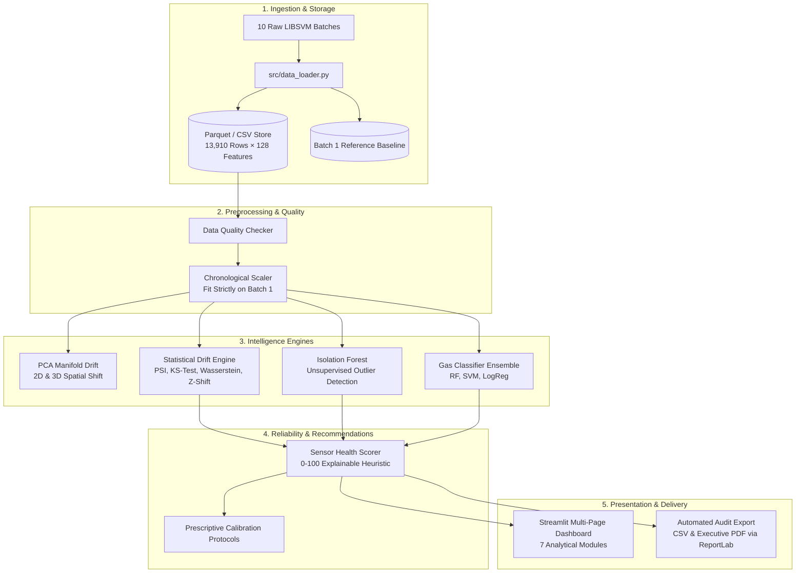

# 🔬 Air Quality Sensor Drift Intelligence
### *An Intelligent Multi-Sensor Reliability, Anomaly Surveillance, and Drift Detection System*

[](https://www.python.org/)
[](https://streamlit.io/)
[](https://scikit-learn.org/)
[](https://plotly.com/)
[](LICENSE)
[]()

---

## 📌 Executive Summary

Chemical gas sensor arrays (electronic noses) deployed in environmental air quality monitoring, industrial safety, and leak detection systems experience significant degradation over time. Metal-Oxide Semiconductor (MOX) sensors suffer from **chemical surface poisoning**, **thermal sintering of tin dioxide ($\text{SnO}_2$) grains**, and **baseline contact resistance creep**. This causes continuous **Sensor Drift**, invalidating pre-calibrated machine learning models, precipitating false gas alarms, and eroding measurement reliability over months of field operation.

**Air Quality Sensor Drift Intelligence** is an end-to-end, production-grade Data Science application that diagnoses multi-sensor drift, monitors array anomalies, quantifies chronological concept drift degradation, and computes an explainable **Sensor Reliability Health Index (0–100)** with actionable calibration guidance.

Built upon the benchmark **UCI Gas Sensor Array Drift Dataset**, this project demonstrates genuine data-driven surveillance across 13,910 real-world physical measurements collected over **36 continuous months**.

---

## 🏗️ System Architecture



---

## 🔬 Dataset Overview (UCI Gas Sensor Array Drift)

- **Source**: UCI Machine Learning Repository ([Dataset #224](https://archive.ics.uci.edu/dataset/224/gas+sensor+array+drift+dataset))
- **Total Measurements**: 13,910 experimental observations.
- **Physical Sensor Array**: 16 Figaro commercial metal-oxide semiconductor sensors (4 of each: TGS2600, TGS2602, TGS2610, TGS2620).
- **Extracted Dimensions**: 128 continuous features ($16 \text{ sensors} \times 8 \text{ features/sensor}$):
  - $f_1$: Maximum steady-state resistance change $\Delta R = \max |R(t) - R_0|$.
  - $f_2$: Normalized steady-state response $\Delta R / R_0$.
  - $f_3 - f_5$: Exponential Moving Average (EMA) rising transient dynamics (fast, medium, slow filters).
  - $f_6 - f_8$: EMA decaying transient dynamic features.
- **Analyte Classes**: 6 toxic/combustible gases (Ethanol, Ethylene, Ammonia, Acetaldehyde, Acetone, Toluene).
- **Temporal Batches**: 10 chronological batches collected over approximately **36 months**.

---

## 🚀 Key Modules & Capabilities

### 1. Data Quality & Leakage-Free Preprocessing (`src/preprocessing.py`)
- Automated detection of missing values, duplicates, and infinite values.
- **Strict Chronological Fitting**: Scalers and reference manifolds are fitted strictly on designated training epochs (Batch 1) to eliminate lookahead bias and data leakage into future operational periods.

### 2. PCA Manifold Drift (`src/feature_engineering.py`)
- Learns the baseline principal component subspace on Batch 1 (explaining ~89.5% variance).
- Projects subsequent batches to reveal spatial trajectory displacement of gas clusters over months.

### 3. Gas Classification & Progressive Degradation (`src/gas_classification.py`)
- Chronological comparison across **Random Forest**, **Linear SVM (Calibrated)**, and **Logistic Regression**.
- Tracks **Concept Drift** batch-by-batch: demonstrates the empirical drop in classification accuracy as the array ages from **99.5% in Batch 1** down to **34.6% in Batch 10**.

### 4. Multivariate Anomaly Surveillance (`src/anomaly_detection.py`)
- Unsupervised Isolation Forest calibrated on baseline measurements.
- Categorizes normal vs anomalous sensor readings and flags batch-wise outlier surges (e.g., Batches 3 and 4 show operational perturbation).
- Distinguishes statistical anomalies from confirmed physical hardware failure.

### 5. Multi-Method Statistical Drift Engine (`src/drift_detection.py`)
- **Population Stability Index (PSI)**:
  $$\text{PSI} = \sum_{i=1}^{K} (Q_i - P_i) \times \ln\left(\frac{Q_i}{P_i}\right)$$
  - $\text{PSI} < 0.10$: Stable / No Drift.
  - $0.10 \le \text{PSI} < 0.25$: Moderate Drift.
  - $\text{PSI} \ge 0.25$: Significant Drift.
- **Two-Sample Kolmogorov-Smirnov (KS) Test**: Maximum empirical CDF divergence ($D$) and statistical significance ($p < 0.05$).
- **Normalized Z-Mean Shift & Variance Ratio**: Parametric tracking of baseline resistance offset and signal volatility.
- **Longitudinal Drift Trajectory**: Batch-wise drift tracking against baseline across all 10 batches.

### 6. Sensor Array Reliability Health Index (`src/sensor_health.py`)
- Explainable composite score (0–100) per sensor computed from:
  - Drift Severity Penalty ($40\%$)
  - Anomaly Rate Resilience ($25\%$)
  - Feature Variance Instability ($20\%$)
  - Model Classification Impact ($15\%$)
- Tiered status:
  - 🟢 **80–100: Healthy** (Normal Operation)
  - 🟡 **60–79: Monitor** (Watch List / Routine Zero-Check)
  - 🟠 **40–59: Warning** (Calibration Advised / Reference Gas Verification)
  - 🔴 **0–39: Critical** (Action Required / Full Baseline Recalibration & Inspection)

### 7. Automated Audit Reports (`src/report_generator.py`)
- Instant export of flagged anomalies (CSV).
- Professional, audit-ready executive PDF report generated using **ReportLab** containing KPI scorecards, 16-sensor status tables, and maintenance guidelines.

---

## 📂 Project Structure

```
air_quality_sensor_drift_intelligence/
│
├── app.py                      # Main Streamlit dashboard entrypoint
├── requirements.txt            # Python dependencies
├── README.md                   # Comprehensive documentation
├── config.py                   # Centralized configuration & constants
│
├── data/
│   ├── raw/                    # Downloaded UCI raw batch files (batch1.dat - batch10.dat)
│   ├── processed/              # Parquet & CSV stores, reference baseline (Batch 1)
│   └── sample/                 # Stratified sample telemetry for testing
│
├── models/
│   ├── gas_classifier.pkl      # Saved Random Forest model
│   ├── anomaly_detector.pkl    # Saved Isolation Forest model
│   ├── scaler.pkl              # Saved Chronological StandardScaler
│   ├── pca_model.pkl           # Saved PCA reference manifold
│   └── model_metadata.json     # Model metrics, features, and classes
│
├── notebooks/
│   └── exploratory_analysis.ipynb # Jupyter Notebook with end-to-end data science walkthrough
│
├── src/
│   ├── data_loader.py          # LIBSVM parser & batch consolidation
│   ├── preprocessing.py        # Quality diagnostics & chronological scaling
│   ├── exploratory_analysis.py # EDA metrics & summary generators
│   ├── feature_engineering.py  # Sensor-level features & PCA manifold analyzer
│   ├── gas_classification.py   # Gas classification & progressive degradation
│   ├── anomaly_detection.py    # Isolation Forest anomaly scoring
│   ├── drift_detection.py      # Statistical drift engine (PSI, KS, Z-shift)
│   ├── sensor_health.py        # 0-100 explainable health scoring module
│   ├── model_evaluation.py     # Metrics tables & degradation statistics
│   ├── visualization.py        # Plotly chart library (Heatmaps, 3D PCA, Radar)
│   ├── report_generator.py     # CSV & ReportLab PDF report generation
│   └── ui_helpers.py           # Shared UI styles, CSS, and cached loaders
│
├── pages/
│   ├── 1_Overview.py           # Telemetry baseline, analyte & batch counts
│   ├── 2_Sensor_Analytics.py   # Feature deep dive, correlation, 2D/3D PCA
│   ├── 3_Anomaly_Detection.py  # Isolation Forest surveillance & anomaly downloads
│   ├── 4_Drift_Intelligence.py # Interactive PSI, KS test, and drift curves
│   ├── 5_Model_Performance.py  # Classifier comparison & progressive degradation
│   ├── 6_Sensor_Health.py      # 0-100 reliability radar & calibration advice
│   └── 7_Reports.py            # Telemetry upload, live inference, and PDF audits
│
├── reports/                    # Generated PDF audit reports & CSV exports
│
└── tests/
    ├── test_data_loader.py     # Parser integrity tests
    ├── test_preprocessing.py   # Chronological scaling & quality tests
    └── test_drift_detection.py # PSI, KS, and health boundary unit tests
```

---

## 💻 Installation & Setup

### Prerequisites
- Python 3.10 or 3.11+
- Virtual environment (recommended)

### 1. Clone & Navigate to Project Directory
```bash
cd air_quality_sensor_drift_intelligence
```

### 2. Install Dependencies
```bash
pip install -r requirements.txt
```

### 3. Verify Dataset & Train Models (Automated)
The dataset is downloaded and parsed automatically on first execution, or you can run the pipeline modules directly:
```bash
# 1. Parse raw LIBSVM batches
python src/data_loader.py

# 2. Fit chronological scaler and PCA
python src/preprocessing.py
python src/feature_engineering.py

# 3. Train models
python src/gas_classification.py
python src/anomaly_detection.py
```

### 4. Run Test Suite
```bash
pytest tests/
```
*(All 8 unit tests should pass with 100% success).*

---

## 🖥️ Running the Application

Launch the Streamlit interactive dashboard:

```bash
streamlit run app.py
```

Open your browser at `http://localhost:8501`.

---

## 🖥️ Dashboard Page Tour

| Page | Key Features |
|---|---|
| **Home (`app.py`)** | System status, executive KPIs, sensor health index, radar overview, and guided navigation. |
| **1. Overview** | Total observations (13,910), gas distribution, batch frequencies, analyte composition contingency matrix. |
| **2. Sensor Analytics** | Individual feature boxplots across 10 batches, inter-sensor cross-correlation heatmap, 2D & 3D PCA drift projections. |
| **3. Anomaly Detection** | Isolation Forest score timeline, decision boundary, batch anomaly rates, downloadable anomaly CSV. |
| **4. Drift Intelligence** | Reference vs Comparison batch selection, PSI calculation, 2-sample KS test, distribution comparison histograms, 10-batch longitudinal drift curve. |
| **5. Model Performance** | Benchmark comparison of Random Forest, SVM, and Logistic Regression; confusion matrix; progressive degradation curve over 36 months. |
| **6. Sensor Health** | 16-sensor 0–100 reliability scores, polar radar chart, health category breakdown, actionable calibration protocols. |
| **7. Reports & Predictions** | CSV telemetry upload, automated schema validation, live inference, on-the-fly PDF audit report generation, and custom model retraining. |

---

## 📖 Methodology & Scientific Domain Notes

### 1. Data Drift vs Concept Drift vs Physical Sensor Aging
- **Data Drift ($P(X)$)**: Shift in the distribution of raw resistance and dynamic transient features. Caused by ambient relative humidity, ambient temperature variations, or sensor aging.
- **Concept Drift ($P(Y|X)$)**: Shift in the conditional relationship between feature signatures and gas class identities. Even if a classifier was $99.5\%$ accurate at calibration, sensor drift shifts the analyte feature clusters across the decision boundary.
- **Physical Sensor Aging**: In tin dioxide ($\text{SnO}_2$) sensors, continuous operation at high temperatures ($300^\circ\text{C}-450^\circ\text{C}$) leads to crystal grain growth (sintering) and irreversible binding of ambient sulfur or silicon compounds.

### 2. Heuristic Disclaimer
The Sensor Health Score (0–100) is an **analytical heuristic** designed for predictive maintenance decision support. A statistical divergence indicates the need for **zero-gas recalibration** or reference gas cross-validation; it should **never** be used as the sole criterion for physically discarding a sensor.

---

## 📚 References

1. **Vergara, A., Vembu, S., Ayhan, T., Ryan, M. A., Homer, M. L., & Huerta, R. (2012)**. *Chemical gas sensor drift compensation using classifier ensembles.* Sensors and Actuators B: Chemical, 166-167, 320–329.
2. **UCI Machine Learning Repository**: Gas Sensor Array Drift Dataset. DOI: [10.24432/C51P4P](https://archive.ics.uci.edu/dataset/224/gas+sensor+array+drift+dataset).
3. **Yamazoe, N. (1991)**. *New approaches for improving semiconductor gas sensors.* Sensors and Actuators B: Chemical, 5(1-4), 7–19.

---

## 📜 License
This project is open-source and released under the **MIT License**.
